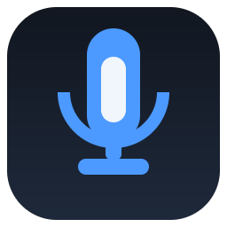

<h1 align="center">
  
  Typewhisper
</h1>

<p align="center"><strong>按住快捷键，在任何光标位置说话，文字直接插进去。</strong></p>

<p align="center">Windows 桌面工具 · 本地语音识别 · 大模型纠偏 · 免安装绿色包</p>

<p align="center">
  <a href="https://github.com/LiangshouX/typewhisper/releases"></a>
  <a href="https://github.com/LiangshouX/typewhisper/blob/main/LICENSE"></a>
  <a href="https://github.com/LiangshouX/typewhisper"></a>
</p>

---

微信的语音输入已经能做到「在任意位置按住说话，文字直接落到光标处」。我们参照它的功能设计做了这一套 —— 适用场景是**内网机器上因合规要求不允许安装微信**的那些地方：功能自己留着，微信不用装。

<p align="center">
  
</p>

## 下载

[Releases 页面](https://github.com/LiangshouX/typewhisper/releases)直接给压缩包，**解压即用**：不写注册表、不装服务、不驻留后台。

首次使用在「设置 → 语音识别」里点「自动检测」，指向本机的语音模型目录即可（DeepSeek Harness 已下载的那份可以直接复用）。

## 它能做什么

- **按住说话，文字落到光标处。** 任何软件的输入框都行：Word、浏览器、IDE、聊天窗口。默认 `Ctrl + Win + K`，在设置页随时改。
- **本地识别，不联网。** 语音模型跑在本机，录音不出机器。
- **大模型纠偏（可选）。** 声学模型听错的同音字（"轻语"听成"清雨"），用大模型加你自己的常用词表改回来。带时间阈值，超时立刻放弃纠偏、录入原文，绝不让你干等。
- **看得见的请求。** 纠偏超时时请求照样发出去，响应回来后补进「请求详情」面板 —— 不是黑箱。
- **麦克风按需开。** 只有你按住快捷键时才打开，松开立刻关；挂在托盘里时隐私指示灯是灭的。
- **录音时有指示条。** 贴在鼠标光标所在屏幕的底部中央，显示真实声波与当前状态。

  <p align="center">
    
  </p>

## 隐私

- 录音只在本机处理，不上传。
- 只有开启大模型纠偏时，识别出的文本会发给你自己配置的端点。
- API Key 明文存在 `%APPDATA%\Typewhisper\settings.json`（Electron 生态的通行做法），共享电脑上请注意。

## 环境要求

- **Windows 10 / 11**
- **语音模型**：SenseVoice（int8）+ Silero VAD，约 240MB。软件不提供下载，请自行准备或复用已有的。
- **大模型（可选）**：任意 OpenAI 兼容端点。不配也能用，只是没有纠偏。

## 开发

```bash
npm install
npm start                  # 开发运行
npm run pack               # 出免安装绿色包 → release/
npm run typecheck          # tsc --noEmit
```

源码在 `src/`：`main/` 是主进程，`renderer/` 是设置页，`shared/contract.ts` 是主进程与界面之间唯一的契约。

自检模式（跑打包好的 exe 即可）：

```bash
"Typewhisper.exe" --selftest      # 麦克风 → 识别 → 纠偏 全链路
"Typewhisper.exe" --hotkey-test   # 按住说话的完整状态机
"Typewhisper.exe" --inject-test  # 文本注入（在自己新建的窗口里做）
```

## 许可

MIT，© LiangshouX。

## 问题

[github.com/LiangshouX/typewhisper/issues](https://github.com/LiangshouX/typewhisper/issues)。
