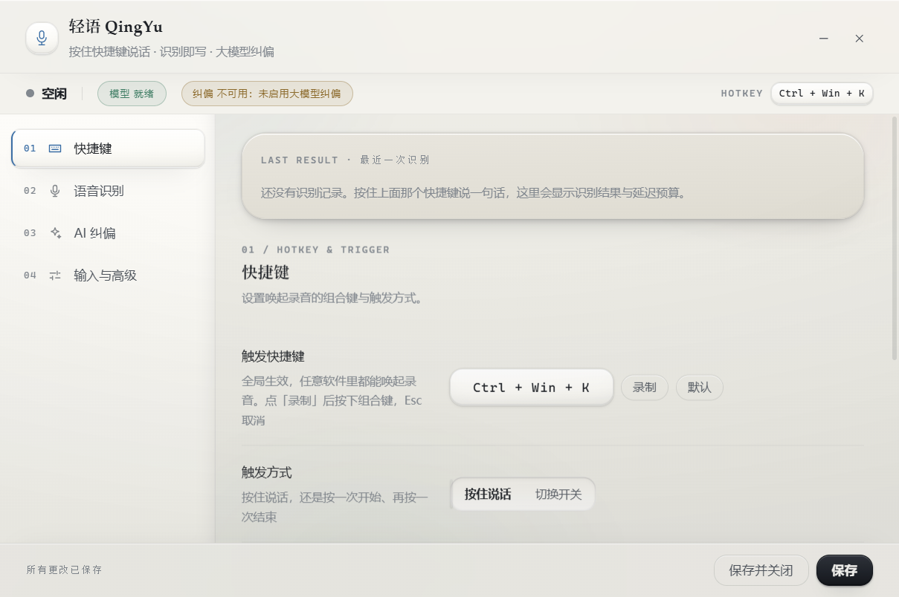
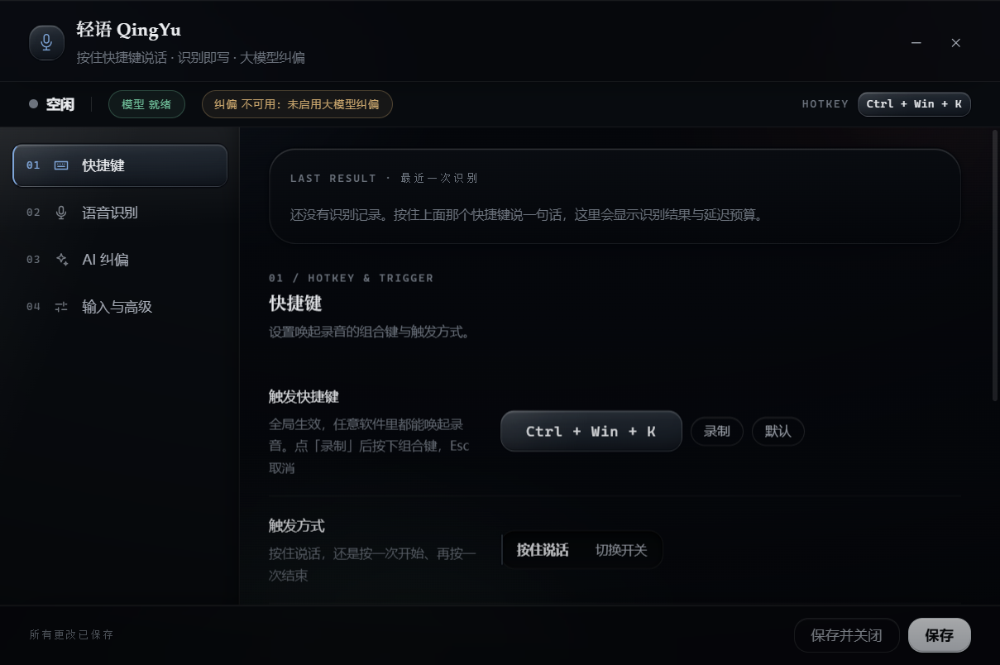
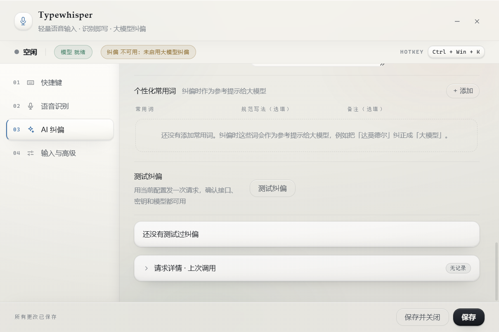

# Typewhisper

**轻量级 Windows 全局语音输入工具** —— 按住快捷键，在任何光标位置说话，识别结果直接插进去。

| 亮色（纸白） | 暗色（素墨） |
|---|---|
|  |  |

录音时浮在**鼠标光标附近**的指示条：


AI 纠偏分区底部的「请求详情」面板（可折叠，能看到上一次请求与响应的原文）：



- 本地语音识别（SenseVoice + Silero VAD，模型复用 DSH 已下载的那份）
- 可选的大模型纠偏（任意 OpenAI 兼容协议），**带时间阈值，超时立刻放弃纠偏、录入原文**
- 全程本地优先：录音不出本机，只有开启纠偏时才会把识别文本发给大模型
- 界面按《组件样式设计最佳实践》做的**纸白 / 素墨双主题**，跟随系统，也可手动切

---

## 它解决什么

「我想在光标处打一段话，但不想打字」。

微信有语音输入，但只在自己的聊天框里用。这个工具把它做成**系统级**的：
在任何软件的输入框里，按住 `Ctrl+Alt+V` 说话，松手，文字就出现在光标处。

轻量的关键不在代码量，而在**不让用户等**：

| 环节 | 预算 |
|---|---|
| 松手 → 本地识别完成 | 通常 200–400ms（SenseVoice int8 比实时快） |
| 本地识别 → 大模型纠偏 | **硬阈值，默认 1200ms** |
| 超过阈值 | 立刻放弃纠偏，录入原始识别文本 |

识别本身在**独立子进程**里跑（模型常驻、启动时预热），主进程永远不卡；
所以悬浮条动画、快捷键响应都是流畅的。

---

## 快速开始

### 1. 准备模型

轻语**不提供模型下载**，直接复用本机已有的 SenseVoice 模型。默认位置：

```
%USERPROFILE%\.dsh\speech-to-text\sensevoice\models
├── sensevoice-onnx\
│   ├── model.int8.onnx     # SenseVoice 识别模型
│   └── tokens.txt
└── silero\
    └── silero_vad.onnx     # 语音端点检测
```

在设置页「语音识别」里点「自动检测」即可；也可以用「浏览…」指向别的目录。

### 2. 运行

```bash
npm install
npm start          # 开发运行
npm run pack       # 打包成免安装绿色包（不产安装程序）
```

打包产物在 `release/`：

```
release/
├── win-unpacked/                      ← 双击 Typewhisper.exe 直接运行
└── Typewhisper-<版本>-win-x64-portable.zip   ← 拷给别人的包
```

> 绿色包是免安装的：解压到任意目录双击即可，不写注册表、不装服务。
> 首次运行会在 `%APPDATA%\Typewhisper\` 下生成 `settings.json` 与 `logs/`。

### 3. 配置纠偏（可选）

设置页 →「AI 纠偏」。默认已经填好了 MiMo：

| 项 | 默认值 |
|---|---|
| 接口地址 | `https://token-plan-cn.xiaomimimo.com/v1` |
| 模型名 | `mimo-v2.6-flash` |
| API Key | **留空，自己粘进去**（设置页里点「测试纠偏」验证） |

> 实测 MiMo `mimo-v2.6-flash` 一次纠偏约 **1.5 秒**。
> 所以纠偏阈值默认给到 **3000ms** —— 原来那种 1200ms 的阈值，
> 对绝大多数真实大模型来说**必然超时**。

| 项 | 说明 |
|---|---|
| **纠偏时间阈值** | 超过这个毫秒数就放弃纠偏，直接录入原文。默认 3000ms |
| 总延迟上限 | 从松手到文字落地的总预算，默认 6000ms |
| 关闭深度思考 | 带上 `enable_thinking:false` / `thinking:{type:'disabled'}`；对端不认会自动去掉重试 |
| 个性化常用词 | 你的专有名词。写成 `轻语 → 轻语` 可以在同音时纠正 |

「测试纠偏」按钮会发一句故意写错的样例（「清语工具」），用来确认词表生效。

### 看得见：请求详情面板

AI 纠偏分区底部有一个**可折叠**的「请求详情 · 上次调用」，展开能看到上一次请求的
地址、请求头（Key 已打码）、请求体、等待时长、响应状态码与响应体。

**关键点**：超过阈值时我们不等了、直接录入原文，但**请求本身照样发出去**，
响应会在后台补进面板。所以「为什么超时」「对端到底返回了什么」都看得见，
不是一个黑箱。

---

## 用法

### 触发方式

- **按住说话**（默认）：按住快捷键说话，松手结束。录音中按 `Esc` 放弃。
- **切换模式**：按一次开始，再按一次结束。适合长段输入。

默认快捷键是 **`Ctrl + Win + K`**（公司内网的机器不装微信，这一组不会撞车）。

> ⚠️ **不要用 `Ctrl+Win+V` / `Ctrl+Win+Space` / `Ctrl+Win+D`** ——
> 这三个被 **Windows 11 自己**占用了（语音输入 / 语言切换 / 显示桌面），
> 实测 `RegisterHotKey` 会直接失败，快捷键根本注册不上。
> 可以用 `scripts/probe-accelerators.cjs` 探测当前机器上哪些组合可用。
>
> 快捷键随时能改：设置页「触发快捷键 → 录制」，按一下新的组合就存好了。
> 如果注册失败，状态条会直接显示原因，不会让你对着没反应的快捷键发呆。

### 插入方式

- **直接敲键盘**（默认）：用 Unicode 事件逐字输入，不碰剪贴板。
- **剪贴板粘贴**：兼容性最好（Word / 老程序），可选是否在粘贴后还原剪贴板。

焦点在识别期间跑掉时，轻语会尝试把焦点切回原来的窗口；切不回就退而写入当前窗口，
不会丢字。

### 为什么需要纠偏

SenseVoice 会把「轻语」听成「清雨」。个性化词表就是干这个的：
把「清雨」纠正回「轻语」，靠的是大模型 + 你的词表，而不是换一个更大的声学模型。

### 录音时的悬浮指示条

按住快捷键后，**鼠标光标所在那块屏幕**的底部中央（任务栏上方）会浮起一个指示条：
圆形麦克风徽标 + 实时声波 + 当前状态（准备麦克风 / 正在录音 / 识别中 / 纠偏中 / 已写入）。

- **跟着光标所在的屏幕走**：你在主屏干活就贴主屏，在副屏干活就贴副屏
- 声波是**真实音量**（约 40fps），不是假动画
- **不抢焦点、鼠标穿透**，绝不挡住你正在点的东西

### 麦克风什么时候开着

**只有你按住快捷键的时候才开**，松开立刻关 —— 跟微信一个做法，
软件挂在托盘里时**隐私指示灯是灭的**。

代价是每次按下要多花一点「打开设备」的时间。实测（这台机器）：

| 场景 | 打开设备耗时 |
|---|---|
| 刚开完就再开（连续说话） | **~150ms** |
| 空闲几秒后再开 | ~500ms |
| 冷启动后第一次 | ~1000ms |

前两档和你「按下 → 开口」的反应时间是重叠掉的，实测不影响体验。
冷启动那 1 秒是 Chromium 音频服务第一次初始化的开销 —— 启动时我们会
**开一次立刻关掉**把设备预热，但设备放久了还是会「变凉」，这个省不掉。

所以：按住快捷键之后，指示条会先显示「准备麦克风…」，等设备就绪才变成
「正在录音」。**看到「正在录音」再开口，就不会丢字。**

音频图（AudioContext + AudioWorklet）是在启动时就建好的，
所以真正临界的只有开设备这一步。

> 关于「实时上屏文字」：SenseVoice 离线模型**不是流式**的，做不到逐字上屏。
> 现在显示的是真实声波；要拿到逐字文本需要换流式模型或走云端流式 API。

### 语言

识别语种只留三个：**自动 / 中文 / English**。
（SenseVoice 本身还支持粤语、日语、韩语，用不到就不摆出来。）

---

## 架构

```
┌─ 主进程 (Electron) ─────────────────────────────────────┐
│                                                          │
│  热键 ──► 流水线 ──► 采集 ──► 识别子进程 ──► 纠偏 ──► 注入│
│           (pipeline)   (隐藏窗口  (utilityProcess)  (koffi │
│                         Web Audio)  SenseVoice+VAD)   SendInput)│
│                                                          │
│  托盘 · 悬浮条 · 设置页 · 日志                            │
└──────────────────────────────────────────────────────────┘
```

### 目录

| 路径 | 作用 |
|---|---|
| `src/main/pipeline.ts` | 流水线编排 + 时间预算 |
| `src/main/asr/` | 识别子进程与协议 |
| `src/main/llm/corrector.ts` | OpenAI 兼容纠偏 + 硬阈值 |
| `src/main/win32/` | Win32 FFI（koffi） |
| `src/main/inject/` | 文本注入（Unicode 敲键 / 剪贴板） |
| `src/main/hotkey/` | 全局热键、按住检测 |
| `src/main/capture/` | 隐藏录音窗口（Web Audio + AudioWorklet） |
| `src/renderer/` | 设置页 |
| `src/hud/` | 悬浮条 |
| `src/shared/contract.ts` | 主进程 ↔ 渲染进程的唯一真源 |

### 关键取舍

- **识别放子进程**：推理是同步的，会阻塞几百毫秒。放子进程里，主进程不卡，原生崩溃也带不走整个软件。
- **模型常驻 + 启动预热**：首次加载约 3 秒，所以启动时就把子进程拉起来。
- **纠偏用流式**：拿到首字就能算剩余预算；超时就回退原文，绝不阻塞。
- **纠偏结果要做合理性检查**：长度偏差过大的结果判定为幻觉，直接丢弃用原文。
- **Unicode 敲键 vs 剪贴板**：默认 Unicode（不污染剪贴板），剪贴板作为兼容选项。

---

## 隐私

- 录音**只在本机**处理，不上传。
- 只有开启「AI 纠偏」时，识别出的文本会发给你配置的大模型端点。
- API Key 明文存在 `%APPDATA%\Typewhisper\settings.json`（Electron 生态的通行做法）。
  在共享电脑上请注意。

---

## 验证与自检

软件自带四种自检模式，直接跑打包好的 exe 即可：

```bash
# 1. 麦克风 → 识别 → 纠偏 全链路（不写入任何窗口）
"release\win-unpacked\Typewhisper.exe" --selftest

# 2. 文本注入（在自己新建的窗口里做，绝不碰你的窗口）
"release\win-unpacked\Typewhisper.exe" --inject-test

# 3. 快捷键状态机：模拟「按住 → 系统自动重复 → 松手」
"release\win-unpacked\Typewhisper.exe" --hotkey-test

# 4. 抓一张设置页截图（开发用）
"release\win-unpacked\Typewhisper.exe" --shot out.png
```

另有独立脚本：

```bash
node scripts/verify-asr.cjs <wav>     # 用本机模型跑一段 wav
node scripts/verify-win32.cjs         # 结构体布局 + 剪贴板往返（不发按键）
node scripts/verify-llm.cjs           # 用真实端点验证纠偏与超时保护
node scripts/verify-llm-trace.cjs     # 用本地 mock 服务验证 trace 与退避重试
node scripts/probe-accelerators.cjs   # 探测本机哪些全局快捷键组合可用
```

> ⚠️ 涉及键盘输入的验证一律带硬护栏：发送前先确认前台窗口是自己拉起的窗口，
> 不等就立刻中止，一个字符都不发。这是踩过坑之后加的，详见
> `src/main/inject/injector.ts` 的 `foregroundGuard`。

---

## 发版到 GitHub Release

仓库：**https://github.com/LiangshouX/typewhisper**
Release：**https://github.com/LiangshouX/typewhisper/releases**

仓库里已经带好工作流：

| 文件 | 作用 |
|---|---|
| `.github/workflows/ci.yml` | 推分支 / 提 PR 时跑类型检查、构建与两组无副作用自检 |
| `.github/workflows/release.yml` | **推 `v*` 标签**时构建免安装绿色包并挂到 Release 页 |

发版只要三步：

```bash
# 1. 改 package.json 里的 version
# 2. 提交并打标签
git tag v0.2.0 && git push origin main --tags
# 3. 等 Actions 跑完，Release 页就有 Typewhisper-<版本>-win-x64-portable.zip 了
```

Release 页会直接给出压缩包链接，用户下载解压即用 —— **不是安装程序**。

> 压缩包文件名只用 ASCII：中文后缀在 CI 的 tar / 控制台编码下会被吃掉
> （实测「免安装」变成空串）。

> 打标签前记得先在本地 `npm run pack` 跑一遍，确认打包没问题。

---

## 开发

```bash
npm run typecheck      # tsc --noEmit
npm run build          # esbuild 打包到 dist/
npm run build:watch    # 监听模式
npm run icon           # 重新生成 build/icon.ico
npm run pack           # 出免安装绿色包（release/）
```

> `npm run pack` 内部会先 `electron-builder --dir` 出目录，再用 `rcedit` 打图标，
> 最后自己压 zip —— 因为 electron-builder 自带的 winCodeSign 压缩包里带符号链接，
> Windows 普通用户解不开，所以跳过它自带的 exe 改写环节。
> 若打包报 winCodeSign 解压失败，先跑 `node scripts/prepare-wincodesign.cjs`。

> 构建脚本会在最后**核对所有入口产物是否齐全**，少一个就直接报错退出。
> （之前漏了 HUD 的 preload，页面里 `window.hud` 悄悄变成了同名 DOM 元素，
> 表现成「悬浮条一直不出现」，排查了很久 —— 所以这道闸门留着了。）

技术栈：Electron + TypeScript + esbuild，渲染层零依赖手写 DOM/CSS。
原生依赖只有两个：`sherpa-onnx-node`（识别）、`koffi`（Win32 FFI）。

---

## 许可

MIT
